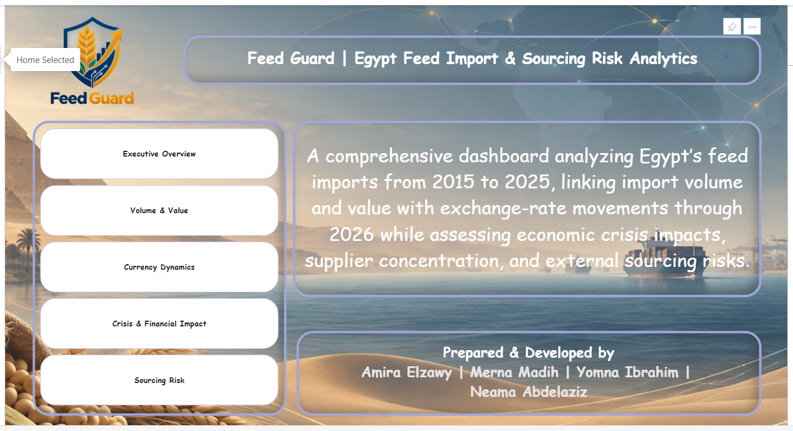

# 🌾 FeedGuard | Egypt Feed Import Analytics

### Turning Agricultural Trade Data into Actionable Insights

FeedGuard is a Data Analytics project focused on exploring Egypt's animal feed import trends, analyzing international trade patterns, and transforming raw data into meaningful business insights.

---

## 📊 Interactive Power BI Dashboard
## 📸 Dashboard Preview
### 🏠 Home

### 📊 Overview

### ⚠️ Sourcing Risk

### 📦 Volume and Value

### 💱 Currency Dynamics

### 📉 Crisis and Financial Impact

Explore the interactive dashboard and discover key insights through data visualization.

[🚀 **OPEN LIVE POWER BI DASHBOARD**](https://app.powerbi.com/cgroups/2cc36221-96bf-4107-9a3a-2a6810e4861c/reports/f41162e5-c263-4437-9b8a-0b99b7e0bae6/d2c4e11e6d75bd111899?experience=power-bi)

---

## 🎯 Project Objectives

- Analyze Egypt's animal feed import trends.
- Explore trade partners and geographical distribution.
- Identify patterns and changes in import activity.
- Present data-driven insights through interactive dashboards.

## 🛠️ Tools & Technologies

| Tool | Application |
|---|---|
| Power BI | Interactive Dashboards & Visualization |
| SQL Server | Data Querying & Data Management |
| Data Analysis | Data Exploration & Insights |
| Data Visualization | Business Intelligence |

## 📈 Key Project Focus

- Import Trends Analysis
- Trade Partners Analysis
- Geographic Distribution
- Business Intelligence Reporting

---

## 👩‍💻 About the Analyst

**Data Analyst | Business Intelligence Enthusiast**

Interested in transforming complex datasets into clear insights that support better business decisions.

**Skills:** Excel | SQL | Power BI | Data Analysis | Data Visualization

---

⭐ *Turning Data into Insights, and Insights into Decisions.*
